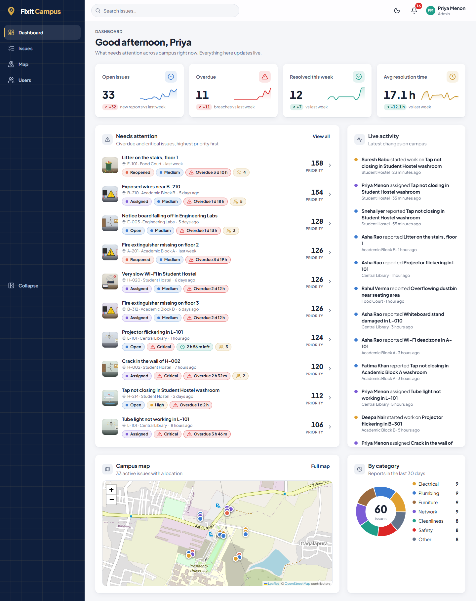
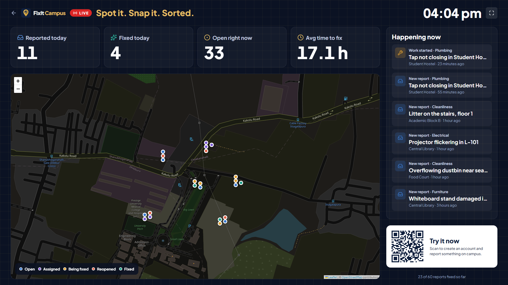
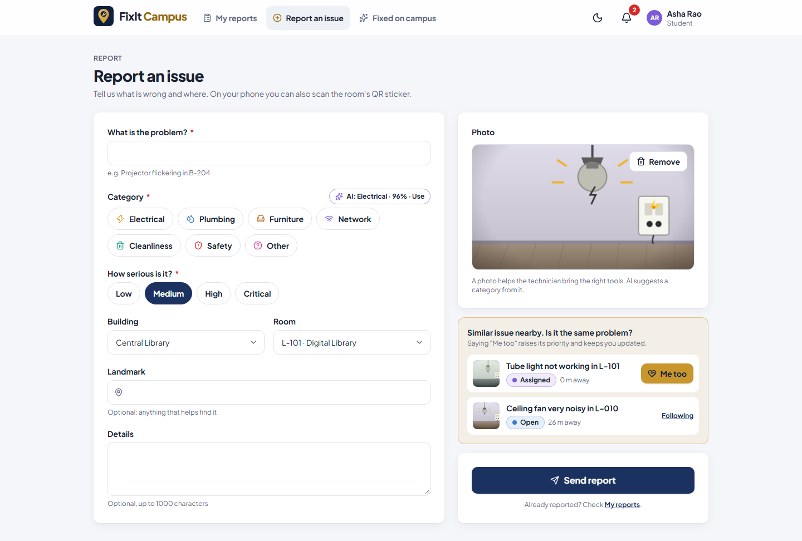

# FixIt Campus

**Spot it. Snap it. Sorted.** Students report campus problems from their phone with a photo, GPS or a room QR sticker. AI (a CLIP model running inside the API, no external service) suggests the category and catches duplicates. Admins triage and assign on a live web dashboard; technicians resolve against SLA deadlines; everyone sees progress in real time.

Built for **MERNOVA X 2026** (Presidency University, MCA final year): one Express REST API and one MongoDB, shared by a React web app and a Flutter Android app.



| Live Booth mode (1920×1080) | Report with AI suggestion and "Me too" |
| --- | --- |
|  |  |

## Contents

- [Features](#features) · [Architecture](#architecture) · [Prerequisites](#prerequisites) · [Setup](#setup) · [Run](#run) · [Demo accounts](#demo-accounts)
- [Mobile app](#mobile-app) · [Phone on the same Wi-Fi](#phone-on-the-same-wi-fi) · [Tests and quality gates](#tests-and-quality-gates) · [Troubleshooting](#troubleshooting) · [Documentation](#documentation)

## Features

| Area | What you get |
| --- | --- |
| Reporting | Photo (camera/gallery), GPS with indoor fallback, **room QR stickers** (`FIXIT:LOC:<code>`), severity, landmark, description, upload progress, compression on the phone |
| AI | CLIP ViT-B/32 inside the API (no API key): category suggestion with confidence; image-similarity **duplicate detection** within 50 m / same room; **"Me too"** instead of duplicates |
| Workflow | Strict status machine (open → assigned → in progress → resolved → closed, reopen ≤ 7 days, reject), **SLA by severity**, priority score, escalation, **auto-close**, **smart assignment** by skill and workload |
| Realtime | Socket.IO with JWT handshake: dashboards, lists, issue pages and the Live Booth update instantly; shared notification inbox (bell on web, screen on mobile); optional FCM push |
| Admin web | Dashboard (KPIs + sparklines, needs attention, live activity, map, donut), issues table with URL filters, issue detail with before/after and smart assign, users, location's with printable A4 QR sheet, **Insights** (heatmap, building health, trends, CSV export), **Live Booth** |
| Student web | My reports with progress steps, report form with AI chip and duplicate check, Fixed on campus feed |
| Mobile | Onboarding, student and technician apps, scanner with torch, "Analysing…" step, duplicate sheet, SLA countdown jobs, open in Maps, before/after slider, dark mode, **biometric unlock**, **offline queue** with idempotent retries |
| Quality | 400+ server tests, end-to-end scenario script, Playwright UI tests, visual QA screenshots in light/dark and phone/desktop, WCAG AA colours, keyboard-usable web |

## Architecture

```text
React web (Vite) ──┐                         ┌── MongoDB (users, locations, issues, notifications)
                   ├─ REST /api + Socket.IO ─┤
Flutter Android ───┘      Express 5 API      ├── CLIP model (transformers.js, cached in server/.cache)
                                             └── Firebase Cloud Messaging (optional)
```

Details, sequence and state diagrams: [`docs/ARCHITECTURE.md`](docs/ARCHITECTURE.md). Every endpoint: [`docs/API.md`](docs/API.md).

## Prerequisites

| Tool | Version used | Needed for |
| --- | --- | --- |
| Node.js | 24 LTS (24.14.1) | API, web, tests |
| MongoDB | 7 or 8, running on `127.0.0.1:27017` | API |
| Flutter | stable 3.44+ with the Android SDK (Android Studio), licences accepted (`flutter doctor --android-licenses`) | mobile app |
| Git | any recent | |

About 300 MB of disk for `node_modules`, plus ~90 MB the first time the AI model downloads.

## Setup

```bash
git clone <this repo> fixit-campus
cd fixit-campus
npm install                                   # installs server/ and client/ (npm workspaces)

cp server/.env.example server/.env            # then edit JWT_SECRET (see below)
node -e "console.log(require('crypto').randomBytes(48).toString('hex'))"   # paste as JWT_SECRET

npm run seed:ai -w server                     # demo data + AI embeddings (first run downloads the model)
#   or: npm run seed -w server                # same data without embeddings (faster, no download)
```

The web app needs no configuration in development (it talks to `http://localhost:5000`). To change it, copy `client/.env.example` to `client/.env`.

### Server environment (`server/.env`)

| Variable | Default / example | Meaning |
| --- | --- | --- |
| `PORT` | `5000` | API and Socket.IO port |
| `MONGODB_URI` / `MONGODB_URI_TEST` | `mongodb://127.0.0.1:27017/fixit` / `…/fixit_test` | Use `127.0.0.1`, not `localhost` |
| `JWT_SECRET` | 32+ random characters | Signs login tokens (required) |
| `JWT_EXPIRES_IN` | `7d` | Token lifetime |
| `CLIENT_ORIGIN` | `http://localhost:5173` | The only web origin allowed by CORS and Socket.IO |
| `UPLOAD_DIR` | `uploads` | Photo folder (git-ignored) |
| `SEED_PASSWORD` | `FixIt@2026` | Password of every demo account |
| `CAMPUS_CENTER_LAT/LNG` | `13.1718`, `77.5362` | Presidency University, Bengaluru (please confirm, DECISIONS D-03) |
| `AI_TRIAGE_ENABLED`, `AI_MODEL_ID`, `AI_TIMEOUT_MS` | `true`, `Xenova/clip-vit-base-patch32`, `8000` | CLIP triage |
| `DUPLICATE_RADIUS_M`, `DUPLICATE_SIMILARITY` | `50`, `0.88` | Duplicate search radius and calibrated threshold |
| `AUTO_CLOSE_HOURS` | `72` | Resolved issues close automatically after this |
| `FIREBASE_SERVICE_ACCOUNT` | empty | Optional push ([`docs/FIREBASE_SETUP.md`](docs/FIREBASE_SETUP.md)) |

The server refuses to start with a missing or invalid value and says which one.

## Run

```bash
npm run dev            # API on http://localhost:5000 + web on http://localhost:5173
```

Open <http://localhost:5173>. In development the login page has one-click demo account buttons.

| Command | What it does |
| --- | --- |
| `npm run dev` | API (auto-restart) + web together |
| `npm run seed -w server` / `npm run seed:ai -w server` | Reset and load demo data (with AI embeddings) |
| `npm test -w server` | Server unit/integration tests (separate `fixit_test` database) |
| `npm run e2e` | Full demo scenario at API level with real sockets |
| `npm run test:ai -w server` | Optional real-model AI smoke test |
| `npm run lint -w client` · `npm run build -w client` | Web lint and production build |
| `npm run test:ui -w client` | Playwright UI tests (starts its own seeded stack on ports 5055/5174) |
| `npm run screenshots -w client` | Visual QA screenshots into `docs/screenshots/web` |
| `npm run create-admin -w server -- --email …` | Create an admin on a real deployment (`ADMIN_PASSWORD` from the environment) |

## Demo accounts

Password for all: **`FixIt@2026`** (`SEED_PASSWORD`).

| Role | Email | Notes |
| --- | --- | --- |
| Admin | `admin@fixit.campus` | Arun Das, web dashboard |
| Technician | `ravi.tech@fixit.campus` | electrical, network |
| Technician | `suresh.tech@fixit.campus` | plumbing, cleanliness |
| Technician | `anil.tech@fixit.campus` | furniture, other, safety |
| Technician | `deepa.tech@fixit.campus` | network, electrical, safety |
| Student | `asha@student.fixit.campus` | has many reports |
| Students | `rahul@`, `sneha@`, `karthik@`, `fatima@`, `arjun@`, `meera@`, `vikram@student.fixit.campus` | |

Any account works on both the web and the app. Students can also register themselves.

## Mobile app

The Flutter project in `mobile/` contains the app code, tests, Android manifests and `MainActivity`. Generate the remaining platform files once (this never overwrites committed files):

```bash
cd mobile
flutter create --org com.fixitcampus --project-name fixit_campus --platforms android .
flutter pub get
dart run flutter_launcher_icons      # app icon from assets/icon
dart run flutter_native_splash:create   # navy splash screen
```

Run on the **emulator** (Android Studio → Device Manager → start a device):

```bash
flutter run --dart-define=API_BASE_URL=http://10.0.2.2:5000
```

`10.0.2.2` is the emulator's name for your laptop. In VS Code use the launch configurations in `.vscode/launch.json` ("FixIt (emulator)" / "FixIt (phone on same Wi-Fi)").

Build an APK:

```bash
flutter build apk --debug --dart-define=API_BASE_URL=http://10.0.2.2:5000
flutter build apk --release --dart-define=API_BASE_URL=https://<deployed API>     # HTTPS only in release
```

Optional push notifications: [`docs/FIREBASE_SETUP.md`](docs/FIREBASE_SETUP.md).

## Phone on the same Wi-Fi

1. Connect the laptop and the phone to the **same Wi-Fi** (or the laptop's mobile hotspot; guest networks often block devices from seeing each other).
2. Find the laptop's IPv4 address: `ipconfig` → "Wireless LAN adapter Wi-Fi" → IPv4 Address, e.g. `192.168.1.10`.
3. Allow the API through Windows Firewall (once, in an **administrator** PowerShell):
   ```powershell
   New-NetFirewallRule -DisplayName "FixIt Campus API 5000" -Direction Inbound -Protocol TCP -LocalPort 5000 -Action Allow -Profile Private
   ```
   Make sure the Wi-Fi network is set to **Private** in Windows settings.
4. Check from the phone's browser: `http://192.168.1.10:5000/api/health` should show `{"status":"ok",…}`.
5. Run or build the app with `--dart-define=API_BASE_URL=http://192.168.1.10:5000` (edit the IP in `.vscode/launch.json`). Debug builds allow plain HTTP; release builds need HTTPS.

## Tests and quality gates

```bash
npm test -w server          # 400+ tests: auth, roles, every status transition, SLA, uploads, AI fallbacks, realtime, jobs, push
npm run e2e                 # the 7-step demo scenario (SPEC 13) incl. socket events
npm run lint -w client && npm run build -w client
npm run test:ui -w client   # Playwright: roles, filters + assign, privacy, realtime, QR sheet, Live Booth
cd mobile && flutter analyze && flutter test && flutter build apk --debug
```

CI runs the same in GitHub Actions (`.github/workflows/ci.yml`).

## Troubleshooting

| Problem | Fix |
| --- | --- |
| `Invalid server configuration: JWT_SECRET …` | Copy `server/.env.example` to `server/.env` and set a 32+ character secret |
| `connect ECONNREFUSED ::1:27017` | Use `127.0.0.1` in `MONGODB_URI` (Node may resolve `localhost` to IPv6) and make sure MongoDB is running |
| `Port 5000 is already in use` | Another API is running; stop it, or set `PORT` (and the clients' URLs) |
| Web shows "Cannot reach the FixIt server" | Start the API (`npm run dev`); check `VITE_API_URL` |
| No AI suggestion | First start downloads the model (~90 MB, needs internet once); `GET /api/health` shows `"ai":"ready"` when loaded; AI never blocks reporting |
| Duplicates not found for seed issues | Seed with `npm run seed:ai -w server` so seed photos have embeddings |
| Phone cannot reach the API | Same Wi-Fi, firewall rule above, `API_BASE_URL` with the laptop IP, test `/api/health` in the phone browser |
| Playwright on Windows says "did not expect test.describe()" | Run it from the folder with its exact case (e.g. `C:\Users\you\Desktop\...`, not `desktop`) |
| Maps are blank | The map tiles come from OpenStreetMap and need internet |

## Documentation

| File | Contents |
| --- | --- |
| [`docs/SPEC.md`](docs/SPEC.md) | The build specification |
| [`docs/API.md`](docs/API.md) | REST and realtime contract, FR → endpoint map |
| [`docs/ARCHITECTURE.md`](docs/ARCHITECTURE.md) | System, sequence and state diagrams |
| [`docs/DECISIONS.md`](docs/DECISIONS.md) | Every decision beyond the spec, with reasons |
| [`docs/DEMO.md`](docs/DEMO.md) | 5-minute booth script and fallback plan |
| [`docs/DEPLOY.md`](docs/DEPLOY.md) | Docker, managed hosting, release APK |
| [`docs/FIREBASE_SETUP.md`](docs/FIREBASE_SETUP.md) | Optional push notifications |
| [`docs/REPORT-NOTES.md`](docs/REPORT-NOTES.md) | Material for the project report and poster |
| [`docs/notes/`](docs/notes) | Per-phase notes with concepts and viva questions |
| [`docs/PROGRESS.md`](docs/PROGRESS.md) | Build progress and items that need you |
