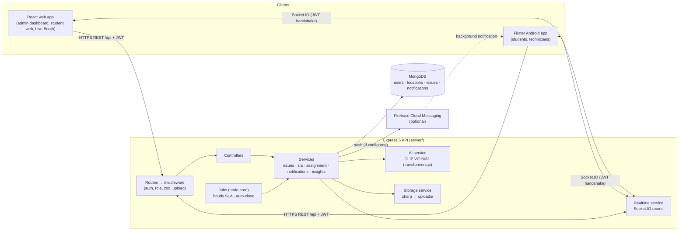
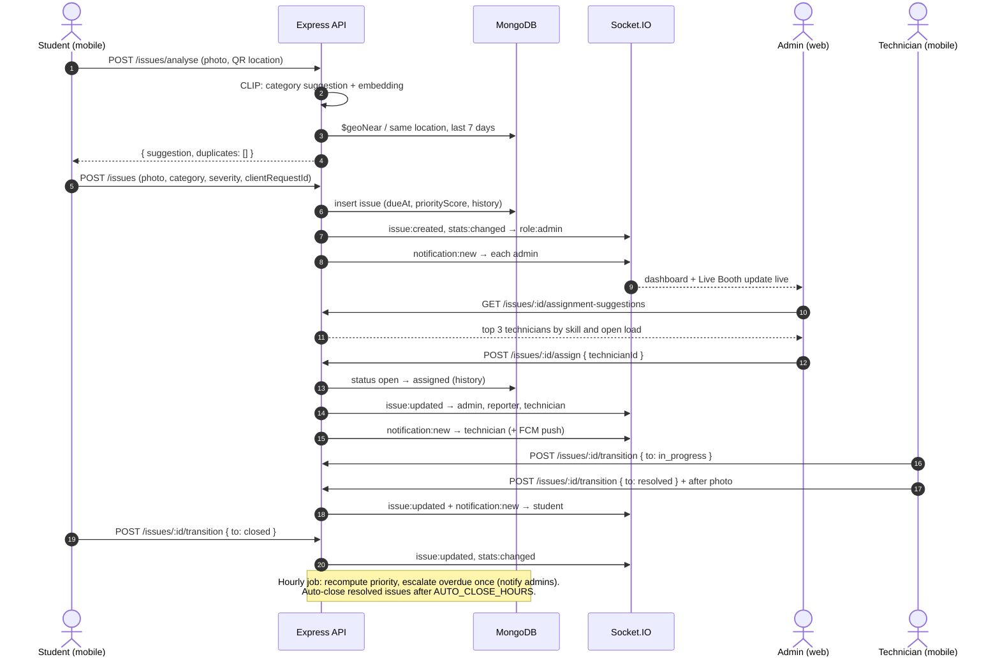
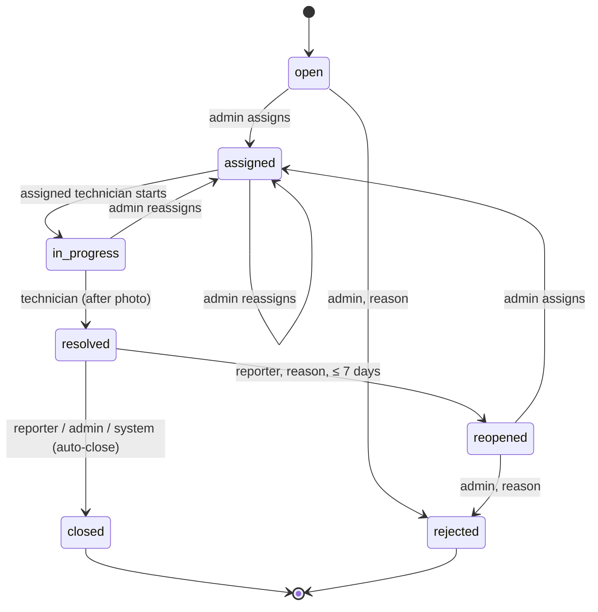

# Architecture

## System

One Express API with Socket.IO on the same HTTP server, one MongoDB. Both apps only talk to the API. The CLIP model runs inside the API process (no external AI service, no API key). Firebase Cloud Messaging is optional and only used for background push.

### Layering

`route → middleware (auth, requireRole, validate, upload) → controller → service → model`

- **Routes** declare the path, the roles, and the zod schema.
- **Controllers** translate HTTP into service calls (read `req`, call one service, send the response). No business rules.
- **Services** hold every business rule: visibility, transitions (`utils/transitions.js` is the only place that decides), SLA/priority, assignment, notifications and realtime events. Events are emitted here so that every path that changes an issue (HTTP, jobs, seed) behaves the same.
- **Models** define schemas and indexes.

### Request lifecycle (report with photo)

1. `multer` keeps the upload in memory (≤ 5 MB, JPEG/PNG by MIME and magic bytes).
2. `sharp` re-encodes it to JPEG (max 1600 px) and a 400 px thumbnail; the storage service writes both with random names.
3. The AI service computes the CLIP embedding (with a timeout) for duplicate detection; failures never block the report.
4. The issue is saved with `dueAt` and `priorityScore`; `statusHistory` gets its first entry.
5. The notification service saves an inbox entry for each admin, emits `notification:new`, and pushes via FCM if configured. The realtime service emits `issue:created` and `stats:changed`.

## Report → assign → resolve → confirm

## Status machine (D1)

## Realtime design

- One Socket.IO server attached to the same HTTP server, CORS limited to `CLIENT_ORIGIN`.
- The handshake carries the JWT in `auth.token`; the middleware verifies it and loads the user (inactive → refused).
- Each socket joins `user:<id>`; admins also join `role:admin`.
- Clients treat events as "something changed": they patch the item in view or refetch, and refetch the whole view after a reconnect, so a missed event can never leave stale data on screen.
- `stats:changed` is throttled server-side to at most one emit per 2 seconds, so a burst of changes does not trigger a burst of KPI queries.

## Security model

- Passwords: bcrypt (cost 10). JWT signed with `JWT_SECRET`, expiry `JWT_EXPIRES_IN`.
- Every protected route runs `auth` and `requireRole` on the server; visibility rules live in the issue service and unauthorised reads return 404 (no existence leak).
- Input: zod on every body/query/params; uploads checked by type, size and magic bytes, then re-encoded (strips metadata such as GPS EXIF from the stored photo).
- helmet headers, CORS allow-list, JSON body limit, rate limiting on login and register.

## Mobile offline queue

Unsent reports are stored on the device as JSON + the compressed image file. A connectivity listener retries with exponential backoff. Each report has a `clientRequestId` (UUID v4); the server's unique sparse index on it turns a repeated POST into "return the existing issue", so retries can never create duplicates.
